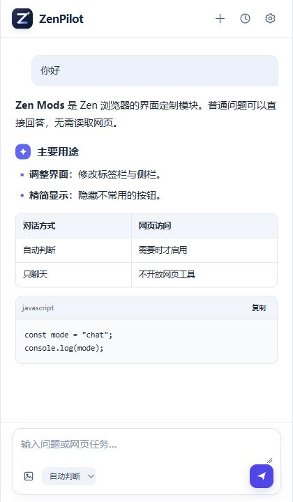
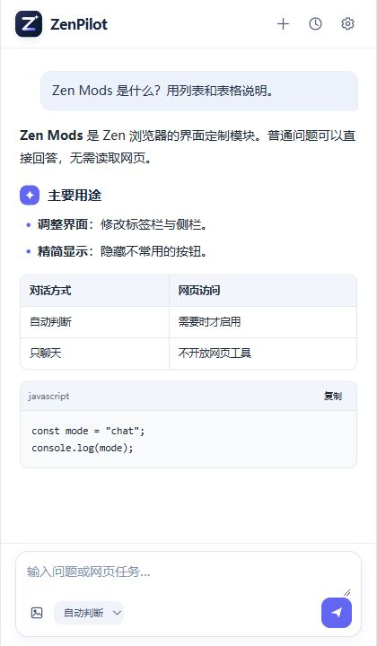
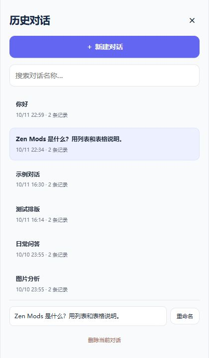

# ZenPilot

**把网页上的事，交给随手可用的侧栏。**

ZenPilot 是面向 Chrome、Zen 和 Firefox 的网页助手。你可以一边浏览，一边让它回答问题、阅读页面、搜索资料，或逐步完成点击、填写和切换标签页等任务。关闭侧边栏后，正在运行的任务仍会在后台继续；重新打开同一对话，就能查看进度。

**当前版本：0.2.9 开发预览版** · [下载最新版](https://github.com/Bohanfree/ZenPilot/releases/tag/v0.2.9) · [更新记录](CHANGELOG.md)

## 界面一览

| 随时开始 | 清晰阅读 | 找回对话 |
| :---: | :---: | :---: |
|  |  |  |

## 可以做什么

- **问答与阅读**：普通问题直接回答；需要网页内容时再读取当前页面。回复支持标题、列表、加粗、表格和代码块。
- **网页任务**：识别可操作元素，点击、填写、选择、滚动、等待结果，也能搜索网页、打开或切换标签页。任务开始后会固定目标，不会因为你浏览别的标签页而误操作。
- **识图**：选择、粘贴或拖入图片提问；支持视觉能力的模型还可分析网页截图。
- **持续对话**：完整记录保存在本机，可搜索、重命名和删除。关闭侧栏后任务继续执行；重新打开同一对话可查看结果、确认操作或停止任务。
- **自己决定操作方式**：可以逐步确认，也可以自动执行；还能选择「只聊天」，完全关闭网页工具。

## 下载与安装

### Chrome 116+

1. 下载 [Chrome 安装包](https://github.com/Bohanfree/ZenPilot/releases/download/v0.2.9/zenpilot-0.2.9-chrome.zip)，解压到固定目录。
2. 打开 `chrome://extensions`，开启「开发者模式」。
3. 点击「加载已解压的扩展程序」，选择解压后直接包含 `manifest.json` 的文件夹。
4. 固定 ZenPilot 扩展按钮，点击它打开侧栏。

更新时用新版文件覆盖原目录，再到扩展管理页点击「重新加载」。从源码安装请先运行 `npm ci` 和 `npm run build`，然后加载 `build/chrome`。

### Zen / Firefox 140+

1. 下载 [Firefox / Zen 安装包](https://github.com/Bohanfree/ZenPilot/releases/download/v0.2.9/zenpilot-0.2.9-firefox.zip) 并解压。
2. 打开 `about:debugging#/runtime/this-firefox`，点击「临时载入附加组件」。
3. 选择解压目录中的 `manifest.json`，再从扩展按钮或浏览器侧栏菜单打开 ZenPilot。

临时附加组件在浏览器重启后会卸载。长期安装需要 Mozilla 签名；这个 ZIP 尚未签名，不能直接作为正式附加组件安装。

## 开始使用

首次打开时，在设置中填写 **API 基础地址、密钥和模型名称**。支持兼容 Chat Completions 的接口以及 OpenAI Responses；例如 API 基础地址可以是 `https://api.example.com/v1`，无需填写完整的 `/chat/completions` 路径。网页操作要求模型支持工具调用，截图分析还要求视觉能力。ZenPilot 不附带模型服务。

可以从这些任务试起：

> 读取当前页面，提炼三个重点，并标出你不确定的地方。

> 在搜索框输入“机械键盘”并搜索，整理前三条结果。

> 帮我检查这张表单，填好姓名和邮箱，但先不要提交。

首次尝试网页操作，建议保留「逐步确认」。自动执行模式会在下一次任务开始时生效。

## 关于后台任务与数据

关闭侧边栏不会主动停止任务。重新打开同一对话，可以看到已保存的回复和进度；如有待确认的操作，也会重新显示。浏览器或扩展重启、后台进程被系统回收后，运行中的任务仍会中断；历史记录会保留，但任务不会自动续跑。

对话与图片保存在本机扩展数据中，不做跨设备同步。ZenPilot 没有内置遥测或开发者服务器；只有你配置的模型服务会收到请求内容，以及任务所需的网页文字或图片。API 密钥存储在本机扩展存储中，没有额外加密层。网页截图仅用于当前模型请求，不写入历史记录。

## 当前边界

- 网页操作主要依赖 DOM 与合成事件；有些网站可能忽略点击或输入。跨域 iframe、关闭的 Shadow DOM、Canvas 控件、复杂拖拽和原生文件选择暂不支持。
- Chrome 截图需要目标网页是当前可见标签页。截图用于视觉分析，不能直接按图中坐标点击。
- 重要的发送、发布、支付或删除操作建议使用逐步确认；自动执行模式没有可靠的语义拦截器。
- 目前回复整段返回，还没有流式文字、长任务自动压缩或浏览器重启后的任务续跑。开发预览版尚未完成所有浏览器与模型服务的实机兼容性验证，也未上架 Chrome Web Store 或 Mozilla AMO。

## 本地开发

```text
npm ci
npm test
npm run check
npm run package
```

打包后会生成 Chrome 与 Firefox 两个 ZIP。Firefox 源码可直接临时载入 `extension/`；Chrome 请加载 `build/chrome`。Markdown 解析与净化库随扩展打包，不从网络加载。更新依赖后运行 `npm run vendor` 同步文件与许可证。

